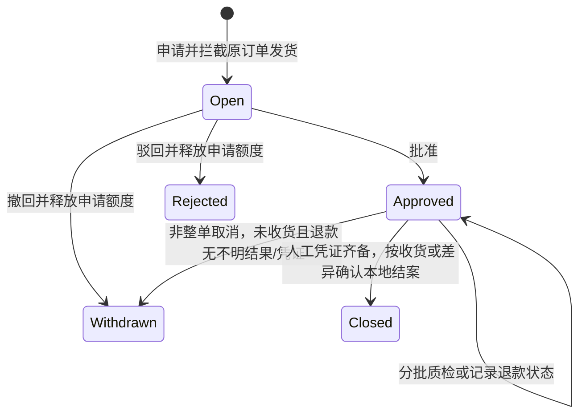

> 版本说明：下文保留早期阶段设计背景。6.4 已加入账号范围、正式空白工作区与主数据；当前权限、任务策略和边界以 [README](../README.md)、[账号说明](accounts-security.md)、[事务说明](business-transactions.md) 为准。真实平台与外部财务仍未连接。正式人工订单使用 DataKind=manual，演示订单仍为 synthetic。

第五步补充：已有有效账单退款关联的售后不能直接撤回/驳回释放额度；先处理账单差异。账单与人工退款凭证保持独立，详见 [finance-design.md](finance-design.md)。下文记录第四步原设计，当前迁移目标为 schema 4。

> 版本说明：本文描述原阶段业务设计。6.2 的认证方式、角色和当前范围以 [账号说明](accounts-security.md) 为准，后续边界以 [开发路线](next-stage.md) 为准。
# 售后、退货与退款跟踪设计

## 四个独立状态

订单审单状态、仓储出库状态、售后状态和退款跟踪状态分别保存。退货不会倒退历史出库数量，也不会恢复历史预占消耗；退回实物作为新的库存流入记账。退款记录不修改主库或隔离库存。

退款跟踪 `Pending / Unknown / Failed / EvidenceRecorded` 对应待登记、结果不明、记录失败、人工凭证已登记。系统没有 PlatformConfirmed 状态入口，也没有真实退款发送器。EvidenceRecorded 只能表达本地人员记录了凭证，不能证明平台资金处理成功。

## 三种申请

| 类型 | 申请范围 | 库存行为 |
|---|---|---|
| CancelUnshipped | 已付款已审核、无任何出库记录的整单；正金额等于原单实付；不能叠加其他有效申请 | 批准时作废所有相关有效包裹，取消目标订单并释放剩余预占；在库不变 |
| RefundOnly | 属于原订单的已出库销售行及数量 | 只记录售后与退款，不允许质检入库 |
| ReturnRefund | 属于原订单的已出库销售行及数量 | 按原出库组件快照生成应退数量；实际验收后良品与残次品分别入账 |

申请及处理当前只开放固定模拟租户、店铺、货主和仓库。未审核订单先处理审核问题。未出库整单取消与部分发货未发部分取消是不同流程，后者本轮未实现。

每次申请按**原出库行**限制数量：`可申请量 = 原出库量 - 非驳回/撤回申请量之和`。处理中和已结案的仅退款、退货退款都会占用数量，防止同一件商品重复申领。驳回/撤回保留历史并释放额度。结案、少退确认和人工凭证均不允许通过删除记录恢复额度。

金额为人工填写的本单申请额，最多两位小数、正数且不超过 10 亿；同一订单有效申请总额不超过原单实付。当前仅支持原模型 CNY。未按商品行自动分摊优惠、运费、税费，也没有自动计算应退金额；本轮金额上限校验不能替代真实平台或财务退款规则。

## 申请与出库的竞争

所有写入使用即时写事务。申请校验当前订单版本及已出库数量后，在同一事务写入售后、行快照、审计、订单新版本和 Outbox 事件。

仓储配单、拣货、扫码、封箱、运单登记及出库在写事务内检查活动售后。新申请 Open 后立即阻断关联订单；合包中任一原订单被拦截，会阻断整个包裹。客户端按钮禁用只是提示，最终规则在服务端执行。

若出库先提交，未出库取消申请因已有出库记录而失败；若取消申请先提交，出库因活动售后而失败。两者不能都成功。驳回/撤回后，其他活动售后仍继续阻断发货。

批准未出库取消时，相关 Draft 可直接作废；Picking/Packed 必须有 `confirmPickedGoodsReturned=true`，确认整包商品已物理归还。涉及其他订单的合包也整包作废，但只释放目标订单的预占，其他原订单可重新配单。这个确认由本地操作人填写，系统并不能感知实物是否真的已归还。

## 质检与库存事务

本轮将收货与质检作为一个明确入账动作，没有独立待检收货单。未验收的实物应保留在现场待处理状态，不通过本命令提前增加库存。

退货组件来自原出库 `ShipmentComponents`，数量为 `原出库组件量 × 申请销售数量 / 原出库销售数量`，必须精确到 0.001，不能表达时拒绝整个申请。售后不会读取新的 SKU 映射或 BOM 来覆盖历史组件快照。

每批质检包含一个全租户唯一 `receiptNumber` 和不重复的 `caseLineId + skuId` 明细；`goodQuantity + damagedQuantity` 必须大于零且不超过该组件剩余应收量。原订单可多包，售后可多行，同 SKU 仍按售后行分别验证，随后按 SKU 汇总入库。

一次质检事务内完成：

1. 校验幂等键、收货批次业务身份、售后版本和 Approved/ReturnRefund 状态。
2. 条件更新每个组件的累计良品、残次品数量，任何一行失败则全批回滚。
3. 保存收货批次和逐行实收数量。
4. 良品加到 InventoryBalances.OnHand，写 ReturnGood 库存流水，关联售后和收货批次；不增加 Reserved。
5. 残次品增加 QuarantineBalances 和 QuarantineLedger；不进入 InventoryBalances，因此不增加 ATP，也不占用普通 Frozen 字段。
6. 增加售后/原订单版本，保存审计、事件和原操作响应，然后提交。

精确到 0.001 的整数数量沿用前三步口径。冻结策略不操作 QuarantineBalances，不能把隔离品误解冻为可售。库存页“在库”是主库口径，物理库存总量若需统计，应另外加上隔离数量。

## 退款记录与结案

记录退款观察不调用平台、不发送资金指令。每次记录包含事件号、固定为本售后申请额的金额、观察时间、说明、操作人和原因。事件号相同且内容一致可重放；内容不同冲突。比最新观察时间更早的记录拒绝覆盖。

EvidenceRecorded 必须填写凭证号、说明，并明确确认人工来源。`租户 + 平台 + 店铺 + 凭证号` 唯一，一张售后最多登记一份凭证，已登记状态不能降级为失败或不明。系统仅对格式及唯一性做校验，没有验证凭证真实性。Unknown 不自动请求平台回查，需人工处理或未来真实适配器接入。

Approved 售后在登记凭证后才能本地结案；ReturnRefund 还必须至少有一笔实物收货。少退时，操作人明确设置 `acceptShortReturn` 并填写原因，系统保存差异标记，未收到部分不会入账。没有任何收货时，不能以少退确认跳过退货流程。Closed 为本地业务归档，不代表平台资金成功核验。

未知退款结果、已登记凭证或已收货均阻止撤回，避免错误释放额度。未出库取消一旦批准，原订单已取消，不允许撤回恢复订单。

## 数据与幂等身份

| 表 | 用途 |
|---|---|
| AfterSaleCases | 售后头、原订单、来源编号、类型/状态、退款申请额和跟踪状态 |
| AfterSaleLines | 原出库行及销售数量，保留规范 SKU/组件快照；整单取消无出库行 |
| ReturnComponents | 每个售后行的应退组件及累计良品/残次品 |
| ReturnReceipts / ReturnReceiptLines | 唯一收货批次、退回运单与实际质检明细 |
| RefundObservations | 有时间顺序的人工观察历史及事件号 |
| RefundEvidence | 每个售后的唯一人工退款凭证及店铺内唯一凭证号 |
| QuarantineBalances / QuarantineLedger | 独立隔离余额与流水 |
| AfterSaleHistory | 申请、审批、撤回、质检、记录退款和结案轨迹 |

InventoryLedger 增加 AfterSaleId、ReturnReceiptId。第三步 Reservation.ConsumedUnits 和 ShipmentMovements 保持历史出库语义，退货不冲掉这些历史记录。

所有变更沿用 Operations 的租户/操作 GUID 唯一约束和完整请求哈希。除此之外：来源售后编号在同店铺平台唯一；收货批次号在租户内唯一；退款事件号在租户内唯一；退款凭证号在同店铺平台唯一。业务重放先于当前版本验证，允许原响应丢失后通过相同业务身份识别已提交操作；异内容不能当作重试。

同一幂等键重试返回原操作响应，可能早于当前状态，之后 GET 最新详情。客户端 pending-commands.json 在发送前写入原请求，网络或服务错误保留，成功或明确非重试 4xx 后移除。

## HTTP 接口

前缀 `/api/after-sales`，全部要求 `X-Erp-Session` 本机会话，最大正文 256 KB，字段 camelCase、枚举为字符串。所有 POST 都需要 operationId（非空 GUID）、actor、reason。actor 自 6.2 起由服务端填写登录身份。

| 方法/路径 | 附加字段或查询 |
|---|---|
| GET /orders | search 原订单号；最近 200 张已审核订单 |
| GET /orders/{id} | 当前订单版本、金额额度和已出库行可申请量 |
| GET /cases | page、pageSize（1–100）、search（售后号/来源号/原订单号）、state |
| POST /cases | orderId、expectedOrderVersion、sourceCaseNumber、kind、refundAmount、lines |
| GET /cases/{id} | 头、原行、组件、收货批次、退款观察历史、操作轨迹 |
| POST /cases/{id}/approve | expectedVersion、confirmPickedGoodsReturned（默认 false） |
| POST /cases/{id}/reject | expectedVersion |
| POST /cases/{id}/withdraw | expectedVersion |
| POST /cases/{id}/inspect | expectedVersion、receiptNumber、returnTracking（可空）、lines |
| POST /cases/{id}/refund | expectedVersion、eventKey、status、amount、refundReference、evidence、observedAt、confirmLocalEvidence |
| POST /cases/{id}/close | expectedVersion、acceptShortReturn（默认 false） |
| GET /quarantine | 隔离余额 |
| GET /quarantine/ledger | 最新 200 条隔离流水 |
| GET /audit | 售后与逆向流水核对 |

申请 `lines` 为 shipmentLineId、quantity；CancelUnshipped 传空数组，由服务读取整单原行。质检 `lines` 为 caseLineId、skuId、goodQuantity、damagedQuantity。所有资源 ID 和长平台标识为字符串。

observedAt 要求显式时区，服务端转换 UTC 存储；不能晚于服务器时间五分钟以上。退款 status 只接受 Unknown、Failed、EvidenceRecorded，Pending 是初始状态。`amount` 必须等于本售后申请额。

成功返回 AfterSaleResult：id、version、state、replayed、message。400 为请求/规则不合法；409 为状态/版本/业务身份/数量额度冲突；503 为数据库忙，可原键重试。一般 500 不提交事务，客户端保留原请求。

## 验证与边界

迁移测试从固定 Stage3 schema 2 数据库升级至 schema 3，并验证原出库、库存、订单及回传不重置；此前 Stage2 schema 1 迁移回归继续保留。故障测试在质检库存更新后抛异常和直接退出子进程，验证数据库重开后无半入库；另测取消和退款记录提交前异常。

并发测试覆盖申请与出库竞争、重复数量申请和并发收货。核对检查原出库申领量、原订单金额上限、收货组件累计、逐 SKU 良品/隔离流水、隔离余额、退款凭证对应关系、取消后的有效包裹/预占，以及结案收货条件。检查不自动修账。

当前不含真实退款、平台消息验签/去重/乱序归并、分单未发部分取消、零金额退货、换货、隔离品处置、结案更正、成本/税费/运费分摊或资金对账。当前流程用于本地模拟验收；生产需认证权限、可信平台事件和独立服务等前提，详见 next-stage.md。
