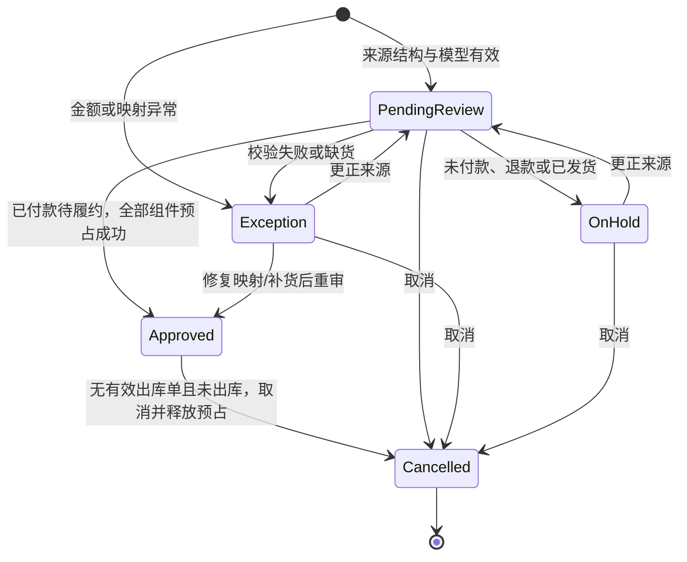

> 当前6.6使用协议7/schema10。库存调整/盘点/隔离/冲销见 [库存单据说明](inventory-documents.md)，当前升级以README为准。

# 订单与库存事务说明

> 版本说明：本文描述原阶段业务设计。6.2 的认证方式、角色和当前范围以 [账号说明](accounts-security.md) 为准，后续边界以 [开发路线](next-stage.md) 为准。
第四步已增加活动售后拦截、未出库整单取消、退货良品和隔离库存，详见 [after-sales-design.md](after-sales-design.md)。直接取消在存在活动售后时被阻止；售后批准取消通过独立事务处理相关包裹和预占。主库流水包含 ReturnGood 和 AfterSaleRelease，隔离品使用独立余额/流水。

## 当前边界

单个模拟租户 `demo-enterprise`，固定货主 `demo-owner`、仓库 `wh-main`，四个登记的模拟店铺。表结构包含隔离维度，但没有开放多租户业务或生产权限系统。所有业务写入都来自本地会话或测试。

Stage3 已在此基础上加入仓储履约，详见 [warehouse-design.md](warehouse-design.md)。审单状态与本地出库状态分开；有有效出库单时，取消须先作废未出库包裹，已出库订单不能直接取消。预占新增 ConsumedUnits，余额核对使用 Active 行的原数量减去已消耗数量。6.3 已增加通用 Outbox 后台处理器；发货回传沿用 DeliveryJobs 专用任务。两者均未连接真实电商平台。

## 表与约束

| 表 | 用途与关键约束 |
|---|---|
| Tenants / Shops / Warehouses / Skus | 租户、登记店铺、货主仓库及内部商品 |
| SkuMappings | 唯一键：租户、平台、店铺、平台商品、平台 SKU；保存映射版本 |
| SalesOrders | 唯一键：租户、平台、店铺、外部订单号；保存来源快照和版本 |
| OrderLines / OrderSnapshots | 当前规范明细、每个订单版本的来源/规则结果快照 |
| InventoryBalances | 唯一键：租户、货主、仓库、SKU；预占+冻结不得超过在库 |
| Reservations | 唯一键：租户、订单、组件 SKU；有效或已释放；Stage3 记录出库消耗，剩余量才是有效预占 |
| InventoryLedger | 期初、预占、释放、补货、策略、出库及操作后余额；操作+动作+SKU 唯一 |
| OrderHistory | 动作、状态前后、原因、规则版本、UTC 时间 |
| Operations | 租户+操作 ID 唯一；请求哈希、业务类型与原响应 |
| Outbox | 事务内事件，聚合 ID+版本+事件类型唯一；6.3 增加租约、重试计划和版本控制 |
| SchemaMigrations | 已应用迁移版本；拒绝较新版本数据库被旧代码打开 |

金额入库存为分；数量以 0.001 为最小单位存 `INTEGER`，不通过 SQLite REAL 比较库存。当前 ATP 不计入在途或预计收货，且不可承诺冻结库存。补货增加在库；预占和取消只改变预占，不改变在库。

## 状态与事务

来源本身已取消时，审单直接记为 Cancelled，不预占；不会自动把已发货单作为本地待发货单处理。订单支付状态与本地审单状态独立。自动审单只是接入事务内的规则执行，不包含定时后台扫描或可视化规则编辑。

写入使用 `BeginTransaction(deferred: false)`。先检查操作键，再检查订单业务键、版本和状态，然后执行库存条件更新及相关表写入。多组件按稳定 SKU 顺序处理。任一组件不足时回滚到预占保存点：已经写入的组件预占、余额版本和流水全部撤销，订单记录为异常。其他数据库/代码异常则整次事务回滚。

取消从数据库读取有效预占，条件更新预占余额、标记释放、记录流水和历史，然后提交。禁止依赖界面上显示的库存数直接覆盖余额。相同取消请求返回原响应；新取消请求若版本过旧返回 409，刷新后再操作。已取消订单不可重审；若再次接入同一来源，返回已存在订单，不重新预占。

SQLite 同时只有一个写事务，本实现验证串行化写入下的正确性，不能由此推算高并发服务器性能。参考：[Microsoft.Data.Sqlite 事务说明](https://learn.microsoft.com/en-us/dotnet/standard/data/sqlite/transactions)。SQL 调用采用同步 ADO.NET；SQLite 的异步 ADO.NET 方法仍同步执行，见[官方异步限制](https://learn.microsoft.com/en-us/dotnet/standard/data/sqlite/async)。

## HTTP 命令

所有接口使用 `X-Erp-Session`，正文最大 256 KB。字段为 camelCase；枚举为字符串。完整来源模型见 `data-model.md` 和 `samples/`。

| 方法/路径 | 请求关键字段 |
|---|---|
| GET /api/business/dashboard | 无 |
| GET /api/orders | page、pageSize（1–100）、search（外部订单号包含匹配）、state |
| GET /api/orders/{id} | 无；返回来源、规范明细、问题、预占与历史 |
| POST /api/orders | operationId、order、autoReview（默认 true） |
| POST /api/orders/{id}/review | operationId、expectedVersion |
| POST /api/orders/{id}/cancel | operationId、expectedVersion、reason |
| POST /api/orders/{id}/correct | operationId、expectedVersion、order、reason |
| GET /api/inventory | 无 |
| GET /api/inventory/ledger | sku 可选；最新 200 条 |
| POST /api/inventory/{sku}/receive | operationId、quantity、reason |
| POST /api/inventory/{sku}/policy | operationId、expectedVersion、frozen、safety、reason |
| GET /api/business/consistency | 无；只检查，不自动修复 |

`operationId` 必须是非空 GUID 字符串。相同逻辑操作重试必须保持其字符串值及完整请求不变，包括 expectedVersion。服务端在同一事务内存储原请求哈希及结果。相同键用于其他载荷、资源或动作返回 409。操作键当前无过期清理。

同外部单号、相同来源内容、不同操作键也会去重；同外部单号来源内容不同则冲突。来源哈希是反序列化后模型的规范序列化哈希，因此 JSON 空白或属性排列不改变身份。已更正来源后，旧载荷不能覆盖新内容。平台事件时间排序、状态归并和回调确认协议尚未实现。

一般错误：400 请求或业务规则错误；401 无有效本地会话；409 内容、状态或版本冲突；413 过大请求；503 数据库忙，可原键重试；500 内部故障，事务不提交。成功入库但审核失败返回 HTTP 200 和 `state=Exception`/`OnHold`。幂等重放的响应可能不是最新订单状态，随后 GET 详情。

客户端在发送前持久化完整命令，确认成功或明确的非重试 4xx 后才移除。网络故障、超时、429、408 和 5xx 保留原命令。文件更新失败也不会在内存中遗忘原幂等键。恢复操作只能重发已保存内容；它不是平台消息 Inbox。

## 数据恢复与生产迁移

测试在预占后直接终止子进程，再重新打开数据库，确认未提交订单、预占、流水和事件整体消失；另外检查提交后重启仍能重放原响应。该检查覆盖进程中断，不是物理磁盘故障、掉电、灾备或多节点故障测试。

订单、库存和 Outbox 在同一数据库事务中的边界可沿用到服务端版，但 SQLite 建表与查询使用了专用 SQL。SQL Server/PostgreSQL 版本须改写迁移和数据库访问，重新验证隔离级别、锁、死锁重试与外键；当前没有完成这两个数据库适配。

## 6.3 持久任务与恢复

业务写事务同时写入 Outbox，后台服务按数据库租约领取；发送与回查在事务之外执行。领取后 60 秒租约到期可接续；外部调用共用 35 秒预算。提交结果须匹配当前租约，旧消费者即使稍后返回也不能覆盖新结果。同一业务对象以版本、创建时间、ID 排序，只有前序全部确认才处理后续；阻断前序会保留后续等待，没有自动跳过机制。此顺序只针对本地业务事件，不是平台入站乱序更新合并。

每个连接器必须用事件 ID 作为稳定幂等标识，提供可信回查：先回查，只有明确未处理才发送。确认结果必须带非空回执。真实目的端须支持幂等或等价去重；租约无法独立消除外部调用已生效但本地未知的重复风险。没有已授权连接器时状态为 Blocked，不伪造成功；代码中未注册真实平台连接器。

| 状态 | 含义和后续 |
| --- | --- |
| Pending | 等待处理，可能等待同一业务对象的前序 |
| Processing | 已领取；异常中断后等待租约到期 |
| RetryWait | 暂时失败；按计划自动回查与重试 |
| Unknown | 结果不明；仍有额度时自动回查，耗尽后等待核查 |
| Blocked | 无连接器或配置冲突；处理条件不足 |
| Failed | 明确拒绝或自动尝试用尽；需人工核查 |
| Confirmed | 连接器已返回回执，不允许再次排队 |

通用业务事件每轮最多尝试五次，间隔为 5、10、20、40 秒；未知结果达到上限仍保持 Unknown，不转成成功或确定失败。人工核查后可重新排队，重置本轮额度但保留累计次数、原任务号和历史。重复操作号返回原结果；错误版本被拒绝，已排队/处理/确认的通用任务不能用新操作号再次排队。重试只处理事件，不重放订单与库存命令。

6.4 发货任务继续使用 ShipmentDeliveryProcessor 与 RetryDelivery，但同样采用每轮五次尝试和 5/10/20/40 秒退避。未知结果耗尽后保持 Unknown 并停止自动尝试；人工核查重排重置本轮额度、保留累计次数。即使连接器忽略取消，调用超时也结束本地等待，外部结果仍须回查。退款的结果不明仍由售后流程核查，不会被这个队列改成退款成功。

OutboxAttempts 保存领取、完成、中断接续记录，TaskActions 保存人工操作；发货任务复用 DeliveryAttempts 和 ShipmentHistory。任务列表每页默认 20、最多 100 项，历史只返回最近 100 条。摘要和筛选在数据库内执行，并在分页前过滤权限。界面需要手动刷新；管理员可手动刷新本地工作进程心跳、过期租约、耗尽额度及长期等待信息；尚无外部告警、自动归档或完整生产监控。

故障测试使用隔离数据与假的外部接收器，并实际终止子进程，验证领取后退出、外部已受理但本地未保存回执、过期消费者晚到及回执提交回滚；不会向真实平台发请求。容量基线通过真实本机 HTTP 验证重复接单、热点 SKU 上限、重复取消和重启原请求恢复，原始结果见 verification。SQL Server 实机、长时间负载和多机网络仍待验收。

## 6.4 正式资料和期初

MasterWorkspace 标记 Demo/Business；正式资料初始化不写入演示业务。MasterSkuData、MasterShopData、MasterMappingState 保存扩展属性和版本；MasterHistory 保存操作人、原因与前后值。映射批量预览不写库，提交再次检查内容摘要、版本和当前资料；任一行失败全部回滚。

OpeningDocuments 待审时不改库存，审核重新检查每行 SKU、库存版本及无流水条件；OpeningSkuClaims 保证同一 SKU 仅一期，库存余额、Opening 流水、StockReceived 事件、操作结果及历史同事务提交。期初仅普通商品数量，不含估值。所有主数据操作绑定操作号、请求内容和真实账号；不同账号不能接管旧操作。

新迁移 008 增加上述资料表、WorkerHealth 及 DeliveryJobs.CycleAttempts。心跳每 15 秒保存，查询最近 24 小时工作进程；数据库故障时无法写入心跳，只能由旧心跳过期反映异常。停止记录不算异常。

## 6.5.1 事务和索引

DbSession.Savepoint 按提供程序生成保存点：SQL Server SAVE TRANSACTION / ROLLBACK TRANSACTION，没有 RELEASE 操作；SQLite SAVEPOINT / ROLLBACK TO / RELEASE。库存不足仍回滚整单预占，外层操作事务继续保存异常状态。

OpeningConfiguration 是当前配置，OpeningPolicyChanges 是版本化变更申请；只有另一策略账号可批准。配置变更与操作结果、审计同事务提交。OpeningDocuments 增加 RequireDifferentApprover 和 PolicyVersion；审核采用单据要求与当前要求的较严格者。

PlatformOrderLines 保存订单来源行键，并在 Lines() 路径与订单新增、更正同事务同步；失败会一起回滚。待映射按异常订单、行键、有效映射和启用SKU关联聚合，筛选和分页在数据库执行。配置迁移与索引回填在schema9升级事务中完成。

## 6.6 库存作业

仓储角色制单、InventoryApprover审核，管理员不能自审或审核自己修改的单据；共享仓单据要求全部店铺和仓库授权。草稿和冲销均有稳定操作号。正式HTTP快捷补货已禁止，改为有依据的单据审批。schema9执行upgrade-inventory至10；SQLite自动升级。SQL实机专项未执行，不能以解析通过替代。库存单据不包含估值和财务凭证。
