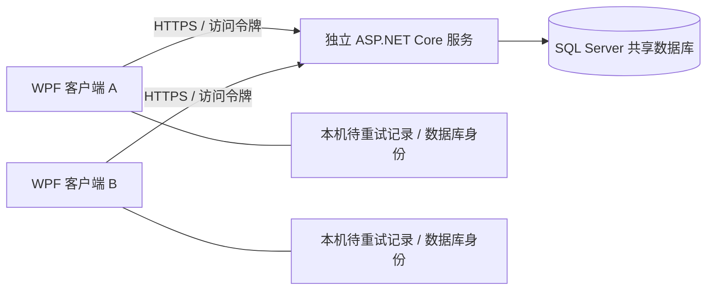

> 当前6.6使用协议7/schema10。库存调整/盘点/隔离/冲销见 [库存单据说明](inventory-documents.md)，当前升级以README为准。

> 当前版本6.5.1要求协议6/schema9；下文早期阶段记录用于背景，当前升级步骤见文末及README。

# 共享服务与数据迁移（6.4 更新）

本次交付把桌面客户端与服务生命周期分离，并实现 SQL Server 数据库适配和迁移工具。默认仍可使用本地 SQLite 模式。现有模拟订单、审单、库存、仓储、售后和财务流程保留。

**验收边界：共享服务已在本机真实 HTTP、多客户端、多进程及 SQLite 数据库上通过验证；SQL Server 建表脚本通过微软 T-SQL 解析器，驱动和迁移代码已编译，但本次环境没有 SQL Server 实例，未执行 SQL Server 实机迁移或业务验收。** 不能据此宣布 SQL Server 生产可用。Windows 服务注册脚本已提供，本次未在操作系统中安装服务。

## 运行方式



- 本地模式：桌面启动随机回环端口的服务，关闭桌面时关闭其自有服务；数据库在 `app/data/commerce.db`。
- 独立模式：`CommerceErp.Api.exe --server 配置文件`；没有桌面父进程依赖，不开放客户端关闭接口。多台客户端连接同一服务即可共享数据。
- 独立模式使用 SQLite 时，数据库文件只放在服务机器的本地磁盘；客户端通过 API 访问，不能把数据库放在网络共享盘上直接打开。
- SQL Server 模式只打开已初始化、版本为 8 的业务数据库。启动服务不会自动建库、覆盖数据或重置版本。

## 本机演示独立服务

解压到当前用户可写的目录，安装 .NET 10 x64 Desktop Runtime 和 ASP.NET Core Runtime。打开 PowerShell，切换到解压目录：

```powershell
# 为当前演示服务生成一个随机令牌；不要把它提交到源码或发送到聊天中。
$env:ERP_SESSION_TOKEN = [Guid]::NewGuid().ToString('N') + [Guid]::NewGuid().ToString('N')
./deploy/Start-Server.ps1 -Configuration ./deploy/server.local.example.json
```

前台窗口保持运行，Ctrl+C 停止服务。客户端运行 `Configure-Connection.cmd`，选择“连接独立服务”，地址填写 `http://127.0.0.1:5088`，令牌通过管理员在本机提供。点击测试连接并保存。配置窗口启动方式会立即使用设置进入客户端；在主窗口“服务连接”中修改的设置，下次启动生效。

该示例新建独立的 `server-data` 模拟工作区，不会自动合并原有 `app/data`。测试两客户端时可使用两份解压后的客户端，连接同一地址；每份客户端有独立的连接档案。

访问令牌默认只保留在内存，下次启动重新输入。可选择使用 Windows 当前用户 DPAPI 加密后保存；若系统无法加密，保存操作会失败，需取消该选项，程序不会使用明文保存作为替代。复制配置到另一 Windows 用户后需要重新输入令牌。

## SQL Server 初始化和迁移

目标为 SQL Server 2019 或更新版本。数据库由管理员预先创建，使用专用空业务库；禁止 master/model/msdb/tempdb 和 AttachDBFilename。连接串必须 `Encrypt=True;TrustServerCertificate=False`，服务器证书须受信任且名称匹配。连接串从本机环境变量或受限文件读取，不作为命令行参数。

示意连接串（替换为自己的实例与库名；这是格式示例，不是可用凭证）：

```text
Server=sql.example.internal;Database=CommerceErp_Test;Integrated Security=True;Encrypt=True;TrustServerCertificate=False
```

SQL 登录也可使用，但密码只在本机填写。正式运行账户与初始化/迁移账户分离：前者只需业务表读写、数据库连接和应用锁权限，后者需要建表等 DDL 权限及数据库 VIEW DEFINITION 权限（完整确认目标为空）。SQL Server 数据库本身的备份、证书、账户及恢复演练由管理员配置。

在本机为数据库工具设置 `ERP_SQL_CONNECTION` 后，二选一：

```powershell
# 全新模拟工作区；只接受空库。
./app/tools/CommerceErp.DatabaseTool.exe initialize-demo --database CommerceErp_Test

# 迁移旧工作区；不要在已经 initialize-demo 的数据库上执行。
./app/tools/CommerceErp.DatabaseTool.exe migrate `
  --source 'D:\ERP-Stage5\app\data\commerce.db' `
  --snapshot 'D:\ERP-Migration\snapshot-001' `
  --database CommerceErp_Test `
  --report 'D:\ERP-Migration\migration-001.json'
```

切换前停止旧客户端和所有写入服务，先处理未完成操作；保留完整的旧工作区备份。迁移工具检查同目录中的待重试记录，非空或损坏时拒绝迁移。不要直接复制旧 `pending-commands.json` 到远程连接档案中。

迁移流程：

1. SQLite Backup API 生成新快照；自动升级的是副本，源数据库文件不被修改。
2. 对副本执行 SQLite 完整性、外键以及库存、仓储、售后、财务一致性检查。
3. 锁定目标数据库并确认没有任何用户表，在单个 SQL Server 事务中建表、按外键顺序导入，保留自增 ID 和原始字段。
4. 逐表比较行数和逐行内容摘要，全部匹配后提交；失败则目标事务回滚，不覆盖原库。
5. 为目标分配新的数据库身份，生成 `Committed` 迁移报告。报告保存失败但提交已经成功时，退出码为 2 并明确提示，不要盲目重跑。

快照目录和报告路径必须全新。历史数据若不满足 SQL Server 字段长度、唯一性或约束，导入会失败并回滚；工具不会截断字段或自动合并冲突记录。应修复源数据后重新生成快照。

仅做快照演练、不写 SQL Server：

```powershell
./app/tools/CommerceErp.DatabaseTool.exe snapshot --source 'D:\ERP-Stage5\app\data\commerce.db' --output 'D:\ERP-Migration\snapshot-check'
```

## 局域网与 Windows 服务

复制 `deploy/server.sqlserver.example.json` 为自己的配置，填写监听地址和证书/凭证文件位置。相对路径以配置文件目录为基准。非回环地址必须启用 HTTPS；客户端拒绝远端 HTTP、不可信证书以及 HTTP 重定向。PFX 密码如有需要从服务账户的 `ERP_HTTPS_PASSWORD` 环境变量读取。

`tokenFile` 为至少 32 字符的随机访问令牌文本，`sqlConnectionFile` 为连接串。它们不是示例包内容，需要管理员在本机创建，并用 NTFS ACL 限制为管理员和服务运行账户可读。API 不输出请求正文、令牌或连接串。不要把 private 目录打包或提交版本库。

先前台运行并完成联调，再以管理员身份执行：

```powershell
./deploy/Install-WindowsService.ps1 -Configuration 'D:\CommerceErp\deploy\server.json'
Start-Service CommerceErp
```

注册脚本使用低权限的 LocalService 账户，默认手动启动，已有同名服务时拒绝覆盖。启动前需授予该账户程序/配置/证书/凭证文件读取权限，以及 SQLite 数据目录写权限（若使用 SQLite）。跨机器 Windows 集成认证通常需要改用有相应数据库权限的域服务账户；LocalService 不是远端 SQL Server 的通用认证方案。服务账户、文件 ACL、证书和自动启动策略需在部署机器上验收。本次没有修改系统服务或防火墙。

## 事务与恢复设计

- SQLite 保留原有持久事务。SQL Server 通过数据库级 `sp_getapplock`：写事务用独占锁，读事务用共享锁。多个 API 实例遵守同一锁协议，避免迁移初期因并发引入不一致。
- 金额、数量继续使用整数单位；所有整数类型经统一读取转换。使用二进制排序规则区分 SKU 等标识的大小写，保留支持的业务键长度。
- 幂等操作结果与业务变更在同一事务中提交。锁超时返回可重试错误；不会生成新操作号自动重做不确定操作。
- 桌面每个连接档案有独立的文件锁、数据库身份和待重试日志。成功回执丢失、认证失败、服务不可用、身份不符时保留日志。
- 每次业务请求携带数据库身份，服务在执行前核对。地址指向另一数据库时拒绝操作；连接设置可明确建立新档案，旧档案保留供核查。
- `Operations`、库存流水和账单等留在数据库；当前并没有把 outbox 接到真实电商平台，也没有把未知退款当作成功。

6.2 起连接令牌只控制服务入口，业务还需个人账号会话。操作人由服务端填写，角色和范围见 [账号说明](accounts-security.md)。本版支持独立正式空白资料库与原演示库。写事务暂时串行，未宣称高并发吞吐指标。

### 6.4 数据库升级

备份并停止所有旧服务与客户端。在本机设置 `ERP_SQL_CONNECTION` 后，由升级账户执行：

```powershell
# 仅 schema 5 先执行账号升级（5→6）。
./app/tools/CommerceErp.DatabaseTool.exe upgrade-accounts --database CommerceErp_Test
# schema 6 执行任务升级（6→7）；已是 7 时重复运行无变更。
./app/tools/CommerceErp.DatabaseTool.exe upgrade-tasks --database CommerceErp_Test
# schema 7 执行主数据升级（7→8）；已是 8 时重复运行无变更。
./app/tools/CommerceErp.DatabaseTool.exe upgrade-master --database CommerceErp_Test
```

任务升级在事务和数据库应用锁内增加事件租约、重试计划及历史表，保留数据库身份。服务只接受 schema 8，不自动升级 SQL Server。SQLite 打开旧库时自动升级至 8。客户端和服务须同步使用协议 5；旧版不兼容。回退需恢复升级前完整备份和对应旧程序。本次仅验证了 SQLite 6→7 保留数据与身份、重复打开，以及 T-SQL 语法；SQL 6→7 实机升级仍待验收。

## SQL Server 实机验收入口

管理员创建新的空测试库，在本机设置 `ERP_SQL_TEST_CONNECTION` 后执行：

```powershell
./tests/Test-SqlServer.ps1 -Database CommerceErp_Test -Report 'D:\ERP-Verification\sqlserver-001.json'
```

脚本真实迁移第五阶段合成夹具，并验证分页查询、跨连接幂等、事务回滚、订单到出库/退货/退款/账单/利润/导出闭环及四类业务审计，并验证账号改权撤销、单店财务查询、审计分页导出、身份核对和管理员恢复。同时覆盖任务领取阻断、授权列表与人工重试。它会向明确指定的空测试库写入合成数据，不自动删库。第二次验收请换新的空库。**本次该脚本仅编译，未在 SQL Server 实例上执行。**

6.3 账号范围与任务恢复已在 SQLite / 本机 HTTP 验证，协议为 5、schema 为 8。上述 SQL 联调脚本测试全新迁移，不能代替从实际旧版本备份执行的 5→6→7→8 升级演练。

可先执行只读环境检查：`./deploy/Test-Environment.ps1 -Report <新报告文件>`。它检测 .NET 10 运行时、CommerceErp 服务状态及 `ERP_SQL_TEST_CONNECTION` 是否配置；有配置时只读取库身份和版本，不建库、不迁移、不输出连接串。身份探测成功也不代表业务、证书部署或服务账户验收通过。

容量脚本 `./tests/Test-Capacity.ps1 -ReportDirectory <全新目录> -Orders 200 -Concurrency 8` 默认使用隔离 SQLite；添加 `-SqlDatabase <专用空库名>` 后使用本机 `ERP_SQL_TEST_CONNECTION` 并写入合成测试数据。已有表时拒绝初始化，不删除目标库。性能报告明确列出提供程序、硬件、吞吐与 P95，不能把 SQLite 结果当作 SQL 或生产结果。

实现依据：[SqlClient 官方说明](https://learn.microsoft.com/en-us/sql/connect/ado-net/download-microsoft-sqlclient-data-provider?view=sql-server-ver17)、[ASP.NET Core Windows 服务托管](https://learn.microsoft.com/en-us/aspnet/core/host-and-deploy/windows-service?view=aspnetcore-10.0)。离线 NuGet 包位于 `lib/packages`，保留上游包中的许可证。

## 6.4 正式空白工作区

本地 `Start-Business.cmd` 使用独立的 `app/business-data`，现有演示库不会被转换。也可通过工具初始化全新目录或预先创建的专用空 SQL 库：

```powershell
./app/tools/CommerceErp.DatabaseTool.exe initialize-business --data 'D:\ERP\business-data' --name '你的企业' --warehouse-name '主仓'
# SQL 连接仅从本机 ERP_SQL_CONNECTION 读取；目标必须为空。
./app/tools/CommerceErp.DatabaseTool.exe initialize-business --database CommerceErp_Business --name '你的企业' --warehouse-name '主仓'
```

随后让独立服务指向对应数据目录或 SQL 库，通过客户端连接后建立管理员。服务健康响应使用 protocol 5 / schema 8，正式模式为 BusinessWorkspace。SQL 主数据建库与升级代码已编译、脚本已解析，但本次没有 SQL 实例，正式建库、7→8 升级和主数据业务仍必须实机验证。SQL 联调入口现已加入主数据草稿修改、幂等、作废、审核及分页专项；本次仅编译未运行。该入口使用迁移后的合成库，仍不能代替正式空库初始化和旧业务库升级演练。

## 6.5 验收清单

本版保持 schema 8 / protocol 5。先停服备份，客户端/API 同步替换为本包；不存在 8→9 升级命令。期初审核策略存于 MasterHistory，备份和恢复须保留。

1. 运行只读 Test-Environment，确认实际 SQL 身份和版本；无连接则记录未执行。
2. 在专用空测试库运行 Test-SqlServer.ps1；专项覆盖新增商品、草稿编辑/重复请求、作废不动库存、新单审核及各分页入口。
3. 另用空库演练 initialize-business，确认没有演示数据，再用两个管理员验证制单/修改人不能审核。
4. 从旧版完整备份按版本执行 upgrade-accounts、upgrade-tasks、upgrade-master；核对身份、账号、余额、订单和任务历史；再次运行不得改账。
5. 在目标机器验证 HTTPS、证书、服务账户、断电/进程中断及备份恢复；本包未替用户执行系统部署。

## 6.5.1 当前部署与验收

客户端/API同步使用本包，协议6/schema9。SQLite自动升级；SQL schema8执行 `upgrade-review --database <明确库名>`，连接从本机ERP_SQL_CONNECTION读取。更早版本先完成5→6→7→8。工具在应用锁和事务内执行009_review及C#策略迁移/索引回填；schema9重复运行无变更。全新SQL初始化与SQLite→SQL迁移同样创建schema9。

实机专项需验证：SQL库存足够时预占、缺货整单回滚、重试幂等、多客户端修改；独立策略申请/批准；旧严格单据不降级；旧策略迁移、历史清理不改配置；索引回填行键与订单来源一致。`tests/Test-SqlServer.ps1` 包含完整迁移与订单闭环，当前新增语法测试还覆盖009及保存点运行语句。**本次环境没有配置SQL实例，以上实机项目未执行。**

备份必须包含整个数据库，包括OpeningConfiguration、OpeningPolicyChanges、OpeningDocuments和PlatformOrderLines。升级前停服并保留旧备份；不支持直接降级。升级数据量较大时先在备份副本演练窗口时间。HTTPS、服务账户、恢复和生产容量仍需在目标机器验证。

## 6.6 库存作业

仓储角色制单、InventoryApprover审核，管理员不能自审或审核自己修改的单据；共享仓单据要求全部店铺和仓库授权。草稿和冲销均有稳定操作号。正式HTTP快捷补货已禁止，改为有依据的单据审批。schema9执行upgrade-inventory至10；SQLite自动升级。SQL实机专项未执行，不能以解析通过替代。库存单据不包含估值和财务凭证。
