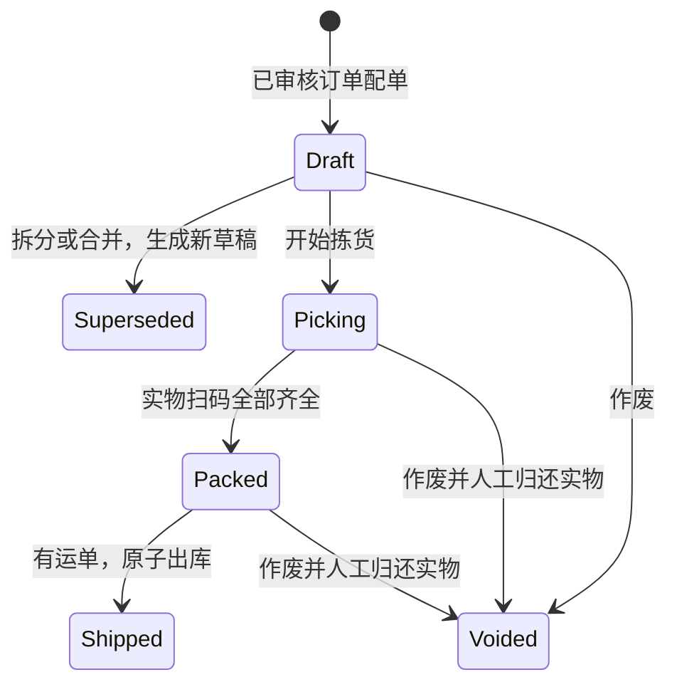

> 版本说明：下文保留早期阶段设计背景。6.4 已加入账号范围、正式空白工作区与主数据；当前权限、任务策略和边界以 [README](../README.md)、[账号说明](accounts-security.md)、[事务说明](business-transactions.md) 为准。真实平台与外部财务仍未连接。正式人工订单使用 DataKind=manual，演示订单仍为 synthetic。

第五步补充：仓库出库事务同时冻结组件成本快照；未配置成本时保留缺失占位，详见 [finance-design.md](finance-design.md)。

> 版本说明：本文描述原阶段业务设计。6.2 的认证方式、角色和当前范围以 [账号说明](accounts-security.md) 为准，后续边界以 [开发路线](next-stage.md) 为准。
# 仓储发货、拆合单与回传设计

本说明记录第三步的仓储基础。第四步增加活动售后拦截和退货流程：配单、拣货、扫码、封箱、运单登记及出库会校验活动售后；按原出库行退货、取消拦截和隔离库存见 [after-sales-design.md](after-sales-design.md)。下文“后续售后”边界已由第四步部分实现，真实平台连接器仍未配置。

## 业务边界

本轮操作固定模拟租户 `demo-enterprise`、货主 `demo-owner`、仓库 `wh-main`，支持内置四个平台的模拟订单。`Approved` 是审单状态，`Unshipped / Partial / Complete` 是根据本地出库数量计算的履约状态；两者独立。来源平台状态仍保存原接单快照，不能把它当作实时平台状态。

一个出库单对应一个物理包裹及一个运单。一个订单可有多包，一包可包含多个原订单，原平台订单号、原行号、平台商品/SKU 标识、内部 SKU 与组件快照全程保留。

## 状态与数量

拆合仅限没有运单的 Draft。拆分产生两个非空新包，原包标记 Superseded；合并同样保留旧包并生成新包。`ShipmentRelations` 保存来向，操作轨迹保存相关 ID；无硬删除。合并限 2–20 个草稿，一包最多 20 个原订单、1000 条订单行。每条订单行本次配单数量不能超过原行数量减去已分配数量。

`已分配 = Draft + Picking + Packed + Shipped 中的数量`；Voided 和 Superseded 不占分配量。`已出库`只汇总 Shipped。按销售单位选择配单量，按审核快照中的实物组件复核和扣库，后续映射变更不会改写历史。

多订单合包必须同平台、同店铺、同货主/仓库，且每张订单明确允许合包。收件人、电话、省市区、街道及邮编清理首尾空白后序列化比较，必须完全相同，不做模糊地址合并。真实平台是否允许该合包方式，还必须通过实际连接器权限和规则验证。

组件量按 `原行组件量 × 本包销售数量 / 原销售数量` 计算；必须精确到 0.001，无法表示时整次拆分或配单回滚，不四舍五入补差。条码只指向启用的实物 SKU，不能扫描虚拟组合 SKU；已登记条码不允许重新指向另一商品。

## 数据表

| 表 | 作用 |
|---|---|
| ShippingProfiles | 原订单收货资料和合包允许标记；变更提高订单版本 |
| Shipments | 包裹状态、运单、收货快照、版本和归属 |
| ShipmentLines | 包裹到原订单行的数量分配及不可变映射快照 |
| ShipmentComponents | 每条包裹销售行实际展开的组件数量 |
| ShipmentChecks | 按物理 SKU 汇总应复核/已复核数量 |
| ShipmentRelations | 拆分、合并后的包裹关联 |
| ShipmentMovements | 已出库包裹按原订单、SKU 记录的实物数量 |
| ShipmentHistory | 配单、扫码、重置、封箱、运单、出库、回传排队等轨迹 |
| SkuBarcodes / WarehouseConfigurationHistory | 实物条码及地址/条码配置审计 |
| DeliveryJobs / DeliveryAttempts | 包裹/原订单唯一回传任务和后台尝试记录 |

`Reservations.QuantityUnits` 保留原预占量，新增 `ConsumedUnits` 记录出库消耗。数据库行 State 仍为 Active/Released；Active 的剩余有效量为 `QuantityUnits - ConsumedUnits`，完全消耗时界面显示 Consumed。已释放行有效量为 0。库存预占余额核对使用剩余有效量，不能把历史 Active 原数量继续计入库存。

`InventoryLedger` 新增 ShipmentId，Ship 流水保留在库、预占的负增量。每包按 SKU 聚合扣总余额，按原订单/SKU 记录消耗；合包不会丢失各原订单的数量归属。

## 事务和竞争

出库使用一个 SQLite 即时写事务：

1. 校验操作键、包裹版本、Packed 状态、运单和复核量，以及原订单仍符合已审核待履约条件。
2. 按原订单/SKU 条件增加 ConsumedUnits，剩余预占不足则全部回滚。
3. 按 SKU 条件更新 `OnHand -= q`、`Reserved -= q`，两项不足都不能提交。
4. 写入出库明细与库存流水，包裹置 Shipped，增加原订单版本、历史和事件。
5. 每个原订单生成一条持久回传任务，保存原操作响应后提交。

提交前异常或进程退出不留下半扣账。提交后客户端丢失响应，原操作键重放返回原结果；已出库包裹以新键再次出库也不会重复扣账。审核、取消、配单和出库的写事务竞争不会产生取消后继续配单或重复扣减。

配单、拆合、扫码、封箱不会再占一次库存；订单审核时已预占。出库同时减少在库和预占，因此 ATP 通常不变。作废只释放分配量，保留原订单预占。当前没有部分退款/部分取消实现，任何已出库记录都会阻止直接取消原订单。

核对包含逐 SKU 组件与复核需求、出库数量与在库/预占流水、订单预占消耗、超额分配、运单/复核完整性以及原订单回传任务数量。检查报告问题，不自动修复库存。

## HTTP 契约

均使用本机会话 `X-Erp-Session`，正文 camelCase，枚举字符串，最大 256 KB。命令使用 GUID operationId；相同逻辑重试应携带原键和完全相同的请求。业务写入使用 expectedVersion；过期版本返回 409。重要操作还需 actor、reason；actor 自 6.2 起由服务端填写登录身份。

下表省略每个 POST 都必需的 operationId、actor。除配单、合单、条码登记外，expectedVersion 指对应资源当前版本。

| 方法/路径（前缀 /api/warehouse） | 说明/附加字段 |
|---|---|
| GET /orders?search= | 最近 200 张已审核订单；按原订单号筛选 |
| GET /orders/{id} | 收货资料、当前版本、按行原数量/已配/已出/可配 |
| POST /orders/{id}/address | expectedVersion（订单）、address、allowMerge、reason |
| GET /shipments | page、pageSize（1–100）、search、state；按包裹/运单/原订单号查找 |
| POST /shipments | lines：orderId、externalLineId、quantity、expectedOrderVersion；reason |
| GET /shipments/{id} | 包裹、原订单行、组件复核、操作轨迹、回传任务 |
| POST /shipments/{id}/split | expectedVersion、lines（lineId、quantity）、reason；lineId 为包裹行 ID |
| POST /merge | shipments（id、version）、reason |
| POST /shipments/{id}/pick | expectedVersion |
| POST /shipments/{id}/scan | expectedVersion、barcode、quantity |
| POST /shipments/{id}/reset | expectedVersion、reason；复核归零，保留历史 |
| POST /shipments/{id}/pack | expectedVersion |
| POST /shipments/{id}/waybill | expectedVersion、carrier、trackingNumber、reason |
| POST /shipments/{id}/void | expectedVersion、reason |
| POST /shipments/{id}/dispatch | expectedVersion、reason |
| GET /barcodes | 实物条码列表 |
| POST /barcodes | expectedVersion（新建 0）、barcode、skuId、reason |
| GET /deliveries | 最近 200 条回传任务 |
| POST /deliveries/{id}/retry | expectedVersion（回传任务）、reason |
| GET /audit | 仓储核对报告 |

`ShippingAddress` 包含 recipient、phone、province、city、district、street，postalCode 可空。所有订单 ID、SKU ID 和长平台标识保持字符串。业务返回 `WarehouseResult`：id、version、state、replayed、message、relatedIds；拆分返回两个新包 ID，原包不再参与配单。

400 为输入/规则错误，409 为版本、状态或重复业务冲突，503 表示数据库忙，可原键重试。成功的本地出库响应不意味着平台发货成功，应再查询回传任务。

## 平台回传与异常恢复

出库写入的 `ShipmentNotification` 按包裹/原订单保留稳定 DeliveryId、平台/店铺/原订单、运单、原行/平台 SKU 和实际包裹数量。IsPartial 表示**本包是否只覆盖原订单的一部分**，即使是完成订单的最后一包也保持这个语义；IsMerged 表示包裹含多个原订单。

本交付没有真实连接器，所有新任务初始 Blocked，原因明确可见；点击重试只将任务排队为 Pending，后台发现未配置连接器后再次置为 Blocked，不制造成功回执。

后台 `ShipmentDeliveryProcessor` 在短事务内认领 Pending、到期 Unknown 或过期 Processing，使用一分钟租约及唯一 LeaseToken。网络调用在事务外，单轮取消预算 35 秒；结果只在 LeaseToken 仍匹配时提交，旧租约响应不会覆盖新结果。服务退出的进行中任务待租约到期后恢复。Unknown 30 秒后再回查；Rejected/Blocked 需处理原因后人工重试。Confirmation 必须带非空回执。

适配真实平台时，`IShipmentGateway` 必须满足：

- `CanHandle` 正确匹配平台；查证店铺授权及每个具体请求是否受支持。两个能力开关默认 false，只有平台确实支持对应语义后才启用。
- `QueryAsync` 以稳定业务身份进行可靠回查。只有能确定请求尚未生效才返回 NotFound；含糊结果应返回 Unknown。不能无条件 NotFound 后重复发送。
- `SendAsync` 保存/传递平台允许的稳定幂等标识；将平台字段、物流代码和拆包语义正确转换。Confirmed 附可核验的平台回执；不可用/拒绝/结果不明分别处理。
- 遵守取消预算和平台限流，避免长时间占用过期租约；返回的 Message/Receipt 不含令牌、密钥、消费者明文或原始敏感响应。生产中需按平台实际约束补足重试和租约策略。

接口本身不能让不提供幂等键或可靠回查的远端自动获得“恰好一次”语义。当前测试用模拟网关覆盖“远端已成功但响应丢失”，证明本地会先回查并且不会再扣库存；真实平台仍需逐一联调。

## 运行限制

本地服务随桌面退出，回传后台不是独立常驻服务。运单为手工登记，HTML 拣货单是仓内凭据，不是物流电子面单。扫码流程按键盘输入及 Enter 实现，尚未用实体扫描枪验证。多仓、多账号权限、消费者信息加密脱敏、批次库位、承运商面单、售后退货和财务均未覆盖。上线前待办见 next-stage.md。
